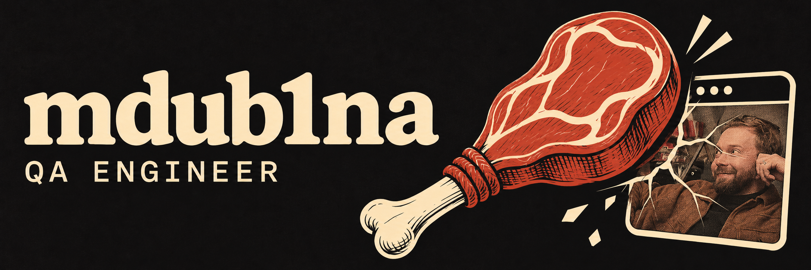

# Hi, I'm mdub1na 👋

## But what does... What mdub1na means?

**M** stands for *myasnya*, or “meat,” because my surname is Myasnikov.

**Dubina** means “a big club.” So, I'm a great meat club.

> *A great meat club that cracks your app.*

Thx 4 ur attention!

---

**QA Engineer working with real devices and the tools that make testing easier.**

## What I work on

- **Device farms** — remote control, device allocation, and shared access to physical devices.
- **Test automation** — infrastructure for Appium and Maestro.
- **Infrastructure** — Linux, Docker, Kubernetes, and builds for amd64 and arm64.
